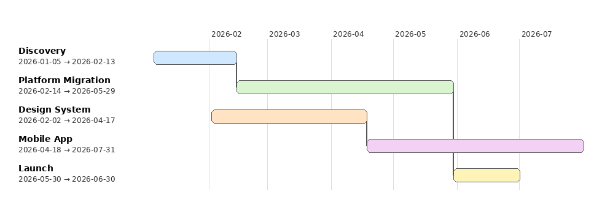

# CTORoad

Draw a roadmap from a JSON file, in the terminal, as PNG, or as SVG.



## Install

    pip install -r requirements.txt

Requires Python 3 with `click`, `Pillow` and `svgwrite`. `pytest` is only needed to run the tests.

## Data

The data is a JSON array of projects:

```json
[
  { "name": "Discovery", "startDate": "2026-01-05", "endDate": "2026-02-13" },
  { "name": "Platform Migration", "startAfter": "Discovery", "endDate": "2026-05-29" }
]
```

| Field        | Required | Notes                                                                 |
|--------------|----------|-----------------------------------------------------------------------|
| `name`       | yes      | Unique. `startAfter` refers to projects by this value.                |
| `endDate`    | yes      | Last day of the project, `YYYY-MM-DD`.                                |
| `startDate`  | one of   | First day of the project, `YYYY-MM-DD`.                               |
| `startAfter` | one of   | A `name` from the file. The project starts the day after it ends.     |

Set exactly one of `startDate` and `startAfter`. The loader rejects duplicate names, unknown `startAfter` projects, bad dates, an end before the start, and `startAfter` cycles. See `roadmap.json` for a full example.

## Usage

Draw the roadmap:

    python ctoroad.py [roadmap.json] [--format {ascii,png,svg}] [-o OUTPUT]

| Format  | Result                                                                        |
|---------|-------------------------------------------------------------------------------|
| `ascii` | Printed to the terminal (default). Colored by project on a TTY unless `NO_COLOR` is set. |
| `png`   | Image, `roadmap.png` by default.                                              |
| `svg`   | Vector image, `roadmap.svg` by default.                                       |

`-o` sets the output path. With `ascii`, it writes plain text to that file instead of printing.

PNG and SVG show month gridlines, and a line joins each project to the one it starts after.

    $ python ctoroad.py
    Discovery                │███████████                                                 │ 2026-01-05 → 2026-02-13
    Platform Migration       │           ██████████████████████████████                   │ 2026-02-14 → 2026-05-29
    Design System            │        █████████████████████                               │ 2026-02-02 → 2026-04-17
    Mobile App               │                             ███████████████████████████████│ 2026-04-18 → 2026-07-31
    Launch                   │                                         ██████████         │ 2026-05-30 → 2026-06-30

## Tests

    pytest
